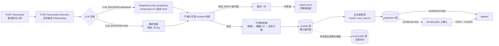

# AI Sales Coach (W1 MVP)

B2B 通话转写 → 异步 AI 复盘（每条结论带原文引用）→ 白名单投影到 CRM。

这不是一个"给销售打分"的工具。复盘里**没有分数**，只有"客户说了什么、下一句该怎么说"，
而且每一句判断都必须能指回通话原文的具体一句。分数是主管的事，走另一张表、另一条读取路径。

## 架构



## 信任工程五件套

1. **无分数复盘** —— `reviews` 表没有任何评分列，Review API 序列化里也没有。
   主管评分走 `scorecards` 表 + 独立 router，两条路径在代码里就不相交，不靠权限控制。
2. **引用校验** —— `needs / emotions / weaknesses / next_actions` 每一条都要带
   `evidence_quote` + `turn_index`。先做精确子串匹配，再做模糊匹配（≥ 0.9），
   两边都不中就把这条**丢掉并计数**。有任何丢弃 ⇒ 该复盘 `confidence=low` 且进抽查队列。
   `praise` 同样是带引用的条目：引用不到就写占位文案「本段暂未识别突出亮点」，不硬夸。
3. **白名单投影** —— 投影源是硬编码白名单元组 `("needs", "next_actions")`。
   其他字段（含 `praise / emotions / weaknesses / script_demo / encouragement`）在代码里
   根本不会被读到，所以新增字段不可能意外泄漏到 CRM。单条回写超 200 字符截断并追加 `…`。
4. **教核隔离** —— 见第 1 条。判断一个复盘做得好不好属于考核，不属于教练；两件事在
   schema 层就分开，主管看不到"AI 说他几分"，销售也看不到自己被评了几分。
5. **低置信抽查** —— `confidence=low` 的复盘进抽查队列（`GET /reviews?spot_check=true`），
   其投影默认 `pending`，销售人工确认后才变成 `applied`。

## 快速开始

```bash
python3.12 -m venv .venv
.venv/bin/pip install -e ".[dev]"     # 或 .venv/bin/pip install -e .

make seed-demo                        # 起 PG16 + pgvector → migrate → 灌 50 通虚构通话
make test                             # 全部单测（用独立测试库，不污染 demo 库）
make live-smoke                       # seed + 对一通真实库数据跑完整主链（LLM 用 stub）
```

本地起 API：

```bash
LLM_BACKEND=stub .venv/bin/uvicorn app.main:app --reload
# 打开 http://127.0.0.1:8000/docs
```

接真实模型：

```bash
export LLM_BACKEND=deepseek
export DEEPSEEK_API_KEY=sk-...
```

`seed-demo` 是幂等的：每次执行先清空 demo 表再灌库，重复执行结果恒为 50 通。

## 数据模型要点

| 表 | 作用 | 关键约束 |
|---|---|---|
| `transcripts` | 通话转写（turns 为 JSONB） | `is_synthetic` 标记虚构语料 |
| `reviews` | 复盘结果与元数据 | **无任何评分列** |
| `projections` | 投影到 CRM 的条目 | 只来自 needs / next_actions |
| `rubrics` | 评分框架版本 | 全库最多一个 active；archived 不可复活 |
| `scorecards` | 主管评分 | 独立表、独立路由 |

rubric 状态机：`draft → active → archived`。导入即校验权重和 = 100（容差 0.01），
不满足直接 422。激活新版本时旧 active 自动归档；激活 archived 版本返回 409（要重新导入新版本）。

## 主要接口

| 方法 | 路径 | 说明 |
|---|---|---|
| POST | `/transcripts` | 导入转写，返回 `transcript_id` |
| POST | `/transcripts/{id}/review` | 触发异步复盘，立即返回 `status=pending` |
| GET | `/reviews/{id}` | 七块结构 + 元数据（status/confidence/dropped/seed/temperature/model/prompt_version） |
| GET | `/reviews?spot_check=true` | 低置信抽查队列 |
| GET/POST | `/reviews/{id}/projections`、`.../{pid}/confirm` | 投影查询与人工确认 |
| POST | `/rubrics/import` | 导入 YAML（raw body 或 `{"yaml": "..."}`） |
| POST | `/rubrics/{id}/activate` | 激活版本 |
| POST | `/scorecards` | 主管按 active rubric 打分 |

## 已知限制

- **模糊匹配可能命中语义相反的句子。** 阈值 0.9 用的是 `difflib.SequenceMatcher` 的字符
  相似度，不做语义判断："这个价可以接受"和"这个价不可以接受"只差一个字，相似度很高。
  本卡只保证丢弃计数与低置信标记正确，语义层风险由人工抽查兜住。
- **引用按 turn_index 定位，跨 turn 错标会被丢弃。** 模型引用的句子如果确实在原文里、
  但 `turn_index` 标到了相邻的一句，校验链会判为「引用不到」并丢弃该条（dropped 计数 +1）。
  这是「引用不到就不说」的保守取向：宁可少说，不给出无法定位的结论。
- **模型输出必须是裸 JSON。** 不接受 markdown 围栏、前后解释文字，也不接受七字段之外的
  额外字段；出现任一情况即按非法输出处理（重试一次 → `status=error`），不做静默裁剪。
  宁可报错，不让一段没按契约产出的内容混进复盘。
- **不做 ASR。** 转写文本由调用方提供（W1 范围）。
- **不做前端。** 演示走 OpenAPI docs。
- **不做话术库检索。** pgvector 已随 compose 起好，W1 未使用。
- **W2 未做。** 金标集 QWK 一致性、分数漂移监控在 W2。
- **stub 后端只用于演示与冒烟**，它产出的是固定结构，不代表真实复盘质量。
  stub 的 `praise` 固定引用开场那一句，语义是否贴切不做保证——它验的是链路，不是文采。
- **fastapi 钉在 0.136.x。** 0.137.0 起 `include_router` 改为惰性 `_IncludedRouter` 节点，
  `app.routes` 不再扁平（不是每一项都带 `.path`），本仓的路由清单断言与排障方式按扁平语义写。
  升级前要先把这些断言改成 `app.openapi()["paths"]`。
