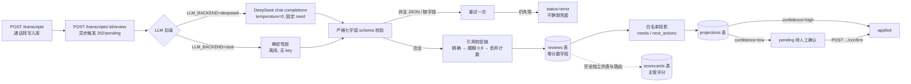

# AI Sales Coach

B2B 销售通话转写 → 异步 AI 复盘（每条结论带原文引用）→ 白名单投影到 CRM。

## 这是什么

一线销售最缺的不是「你这段说得不好」，而是「客户刚才那句话到底什么意思、下一句该怎么说」。
主管复盘一次通话要 20 分钟，一天只能覆盖几个人。这个项目做的事：把通话转写丢进来，
异步产出一份**七块结构**的复盘 —— 亮点、客户需求、情绪、薄弱点、下一步动作、话术示范、鼓励，
**每条结论都必须能指回通话原文的某一句话**，指不回去的条目不写、只计数。

两个刻意的设计取向：

- **这不是一个「给销售打分」的工具。** 复盘里没有任何分数；主管评分走独立的 `scorecards`
  表和独立路由，两条路径在 schema 层就分开。
- **宁可不写，也不写无法定位的结论。** 引用校验失败就丢弃该条并计数，而不是让模型自由发挥。

## 架构



## 信任工程五件套

1. **无分数复盘** —— `reviews` 表没有任何评分列，Review API 序列化里也没有。
   主管评分走 `scorecards` 表 + 独立 router，两条路径在代码里就不相交，不靠权限控制。
2. **引用校验** —— `needs / emotions / weaknesses / next_actions` 每一条都要带
   `evidence_quote` + `turn_index`。先做精确子串匹配，再做模糊匹配（≥ 0.9），
   两边都不中就把这条**丢掉并计数**。有任何丢弃 ⇒ 该复盘 `confidence=low` 且进抽查队列。
   `praise` 同样是带引用的条目：引用不到就写占位文案「本段暂未识别突出亮点」，不硬夸。
3. **白名单投影** —— 投影源是硬编码白名单元组 `("needs", "next_actions")`。
   其他字段（含 `praise / emotions / weaknesses / script_demo / encouragement`）在代码里
   根本不会被读到，所以新增字段不可能意外泄漏到 CRM。单条回写超 200 字符截断并追加 `…`。
4. **教核隔离** —— 见第 1 条。判断一个复盘做得好不好属于考核，不属于教练；两件事在
   schema 层就分开，主管看不到"AI 说他几分"，销售也看不到自己被评了几分。
   质量评估（下面 W2 那一节）落在 `eval_runs` / `eval_scores` 两张表，与 `reviews` 零外键。
5. **低置信抽查** —— `confidence=low` 的复盘进抽查队列（`GET /reviews?spot_check=true`），
   其投影默认 `pending`，销售人工确认后才变成 `applied`。

## 怎么跑

```bash
python3.12 -m venv .venv
.venv/bin/pip install -e ".[dev]"     # 或 .venv/bin/pip install -e .

make seed-demo                        # 起 PG16 + pgvector → migrate → 灌 50 通虚构通话
make test                             # 全部单测（用独立测试库，不污染 demo 库）
make eval                             # 质量评估：QWK + 逐维分 + 混淆矩阵
make drift                            # 分数漂移检查：与 eval/baseline.json 逐通逐维比对
make live-smoke                       # seed + 对一通真实库数据跑完整主链（LLM 用 stub）
```

本地起 API：

```bash
LLM_BACKEND=stub .venv/bin/uvicorn app.main:app --reload
# 打开 http://127.0.0.1:8000/docs
```

接真实模型：

```bash
export LLM_BACKEND=deepseek
export DEEPSEEK_API_KEY=sk-...
```

`seed-demo` 是幂等的：每次执行先清空 demo 表再灌库，重复执行结果恒为 50 通。
`make eval` / `make drift` 会先跑 `seed-demo`，所以在空仓上也能一条命令跑起来。

## 质量评估（W2）

`make eval`（= migrate + seed-demo + eval_qwk）对 50 通合成语料跑一遍复盘质量评估：
每通复盘 → 确定性评分器给五个维度分（D1 引用密度 / D2 需求覆盖 / D3 弱点精确度 /
D4 行动可执行性 / D5 结构完整）与加权总分，再与金标算 **QWK（quadratic weighted kappa）**
和逐档混淆矩阵，结果落 `eval_runs` / `eval_scores` 两张 eval 专属表。

单跑：

```bash
.venv/bin/python scripts/eval_qwk.py --expect-stable-rerun
# qwk=… qwk_by_dimension=… confusion=… eval_run_id=… eval_isolation=OK
```

**金标是生成器的设计档位（good=5 / mid=3 / bad=1），设计档位不是人评。** 它衡量的是
「评分器读出的内容与该通电话的设计强度是否同向」，不是「复盘说得好不好」；真实信度要靠下面
的人工校准。`--expect-stable-rerun` 在同一进程跑两轮并要求 QWK、逐维 QWK、混淆矩阵逐位相同 ——
漂移监控拿它当基线，基线自己会晃就没有意义。

分数怎么算（常数写死在 `app/services/eval_scoring.py`，改常数即换尺子，等于开新卡）：

| 维度 | 口径 | 1 / 3 / 5 |
|---|---|---|
| D1 引用密度 | 五类条目中带非空引用的占比 | `0` / `(0,0.5]` / `>0.5`；空复盘直接记 1 |
| D2 需求覆盖 | `needs` 条数 | 0 / 1 / ≥2 |
| D3 弱点精确度 | `weaknesses` 条数 | 0 / 1 / ≥2 |
| D4 行动可执行性 | `next_actions` 含时间/数量/角色线索的占比 | `0` / `(0,0.5]` / `>0.5` |
| D5 结构完整 | 七字段齐全、非空、praise 非占位 | 二值：1 / 5 |

总分 = `0.3·D1 + 0.2·D2 + 0.2·D3 + 0.2·D4 + 0.1·D5` 四舍五入并夹到 [1,5]。
整套评分不调用 LLM：LLM 打分不可回归，且会把「prompt 漂移」和「评委漂移」耦成一个变量。

**读懂数字。** 离线 stub 后端对每通电话产出同一套条目（它对档位是盲的），所以预测标签恒定、
QWK 按定义就是 0 —— 这时的 eval 验的是链路与确定性，不是质量。接上真实 LLM 后端后，同一条命令
才是真正的质量度量。

### 分数漂移监控

prompt、模型或评分器一改，最该先回答的问题是「分数动了没有」，而不是「QWK 好看了没有」。

```bash
# 1) 把当前状态冻结成基线（只在**有意**确立新基线时跑）
.venv/bin/python scripts/eval_qwk.py --write-snapshot eval/baseline.json
# snapshot=eval/baseline.json rows=50

# 2) 日常检查：重跑并与基线逐通逐维比对
make drift
# distribution={…}  distribution_changed=no
# drift=OK rows=50 matched=50
```

基线是**确定性快照**：`eval/baseline.json` 存每通每维的分数、金标与报告，序列化按 key 排序、
固定行序、结尾换行，**不含时间戳与 run id** —— 否则基线自己就会漂。

- 任何一通的 `gold`、任一维分数、`total`、或报告本身变了 ⇒ `drift=DRIFT` + `drift_diff=…` + exit 1。
  多一通、少一通同样算漂移。
- `distribution=` 打印五维与总分的 1-5 直方图，`distribution_changed=yes/no` 只作人工参考，
  **不判红** —— 改 prompt 本来就会移动分布，把「分布变了」当失败等于禁止改进。
- 只在有意的改动后才重写基线；把 `--write-snapshot` 塞进日常流程会让漂移监控永远绿。

### 人工校准（一次性）

```bash
.venv/bin/python scripts/make_calibration_sheet.py --count 10 --out calib.csv
# 表头 transcript_id,title,human_score,note；human_score 留空；文件里没有档位、没有 AI 分（盲评）
.venv/bin/python scripts/eval_human.py --scores calib.csv   # 填完后读回，打印 human_qwk=
```

留空的行会被跳过（填一半的表现在是正常状态）；非空但不是 1-5 整数（含 `-1`、`abc`）直接
报错并指出行号；一行有效评分都没有时 exit 2 —— 没有可比数据不是「通过」。

## 数据模型要点

| 表 | 作用 | 关键约束 |
|---|---|---|
| `transcripts` | 通话转写（turns 为 JSONB） | `is_synthetic` 标记虚构语料 |
| `reviews` | 复盘结果与元数据 | **无任何评分列** |
| `eval_runs` / `eval_scores` | 质量评估结果 | 不引用 `reviews`（零外键） |
| `projections` | 投影到 CRM 的条目 | 只来自 needs / next_actions |
| `rubrics` | 评分框架版本 | 全库最多一个 active；archived 不可复活 |
| `scorecards` | 主管评分 | 独立表、独立路由 |

rubric 状态机：`draft → active → archived`。导入即校验权重和 = 100（容差 0.01），
不满足直接 422。激活新版本时旧 active 自动归档；激活 archived 版本返回 409（要重新导入新版本）。

## 主要接口

| 方法 | 路径 | 说明 |
|---|---|---|
| POST | `/transcripts` | 导入转写，返回 `transcript_id` |
| POST | `/transcripts/{id}/review` | 触发异步复盘，立即返回 `status=pending` |
| GET | `/reviews/{id}` | 七块结构 + 元数据（status/confidence/dropped/seed/temperature/model/prompt_version） |
| GET | `/reviews?spot_check=true` | 低置信抽查队列 |
| GET/POST | `/reviews/{id}/projections`、`.../{pid}/confirm` | 投影查询与人工确认 |
| POST | `/rubrics/import` | 导入 YAML（raw body 或 `{"yaml": "..."}`） |
| POST | `/rubrics/{id}/activate` | 激活版本 |
| POST | `/scorecards` | 主管按 active rubric 打分 |

## 能力边界

诚实列清楚，省得读者从代码里猜：

- **离线 stub 只是链路验证。** stub 后端对每通电话产出同一套条目，`praise` 固定引用开场那句；
  它验的是管线与确定性，不代表真实复盘质量。要看质量必须接真实 LLM 后端。
- **QWK 现在是 0，不是因为质量差。** 在 stub 下预测标签恒定，QWK 按定义就是 0。接上真实后端后
  同一命令才有度量意义；届时 QWK 的绝对值也会受金标口径（设计档位 vs 人评）限制。
- **不接真实通话、不做 ASR。** 转写文本由调用方提供，音频处理不在范围内。
- **没有前端。** 演示走 OpenAPI docs（`/docs`）。
- **不做话术库检索。** pgvector 已随 compose 起好，目前未使用。
- **模糊匹配可能命中语义相反的句子。** 阈值 0.9 用的是 `difflib.SequenceMatcher` 的字符
  相似度，不做语义判断："这个价可以接受"和"这个价不可以接受"只差一个字，相似度很高。
  代码只保证丢弃计数与低置信标记正确，语义层风险由人工抽查兜住。
- **引用按 turn_index 定位，跨 turn 错标会被丢弃。** 模型引用的句子如果确实在原文里、
  但 `turn_index` 标到了相邻的一句，校验链会判为「引用不到」并丢弃该条（dropped 计数 +1）。
  这是「引用不到就不说」的保守取向：宁可少说，不给出无法定位的结论。
- **模型输出必须是裸 JSON。** 不接受 markdown 围栏、前后解释文字，也不接受七字段之外的
  额外字段；出现任一情况即按非法输出处理（重试一次 → `status=error`），不做静默裁剪。
  宁可报错，不让一段没按契约产出的内容混进复盘。
- **fastapi 钉在 0.136.x。** 0.137.0 起 `include_router` 改为惰性 `_IncludedRouter` 节点，
  `app.routes` 不再扁平（不是每一项都带 `.path`），本仓的路由清单断言与排障方式按扁平语义写。
  升级前要先把这些断言改成 `app.openapi()["paths"]`。
